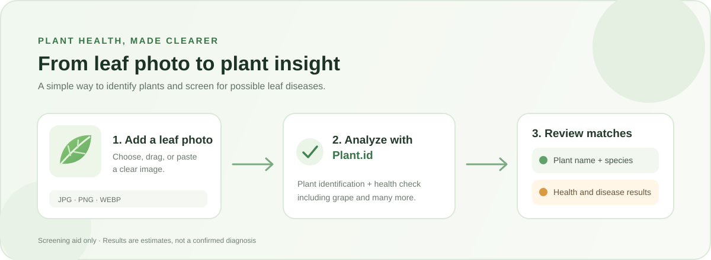

# LeafCheck

A Flask app that sends a leaf photo to the Plant.id API for plant identification
and health assessment. It supports plant species outside a fixed local label
set, including grape, and shows the API's plant and disease matches.



## Setup

1. Use Python 3.10 or later and install dependencies:

   ```powershell
   python -m pip install -r requirements.txt
   ```

2. Get an API key from the [Kindwise admin panel](https://admin.kindwise.com/).
   Plant.id requires an API key; each request may use account credits.

3. Set the key in the same PowerShell window you will use to run the app:

   ```powershell
   $env:PLANT_ID_API_KEY = "your-api-key"
   python app.py
   ```

   Keep the key private. Do not put it in frontend code or commit it to source
   control.

4. Open http://127.0.0.1:5000. Choose, drag, or paste a JPG, PNG, or WebP image.

## API and privacy

The app calls the [Plant.id API v3](https://plant.id/docs) with both plant
identification and health assessment enabled. The uploaded image is sent to
Plant.id for processing; review the provider's current terms and privacy policy.
The app does not save uploaded images locally.

The API's names and match scores are estimates, not a confirmed species or
disease diagnosis. Check important results with a qualified local agriculture
expert.
